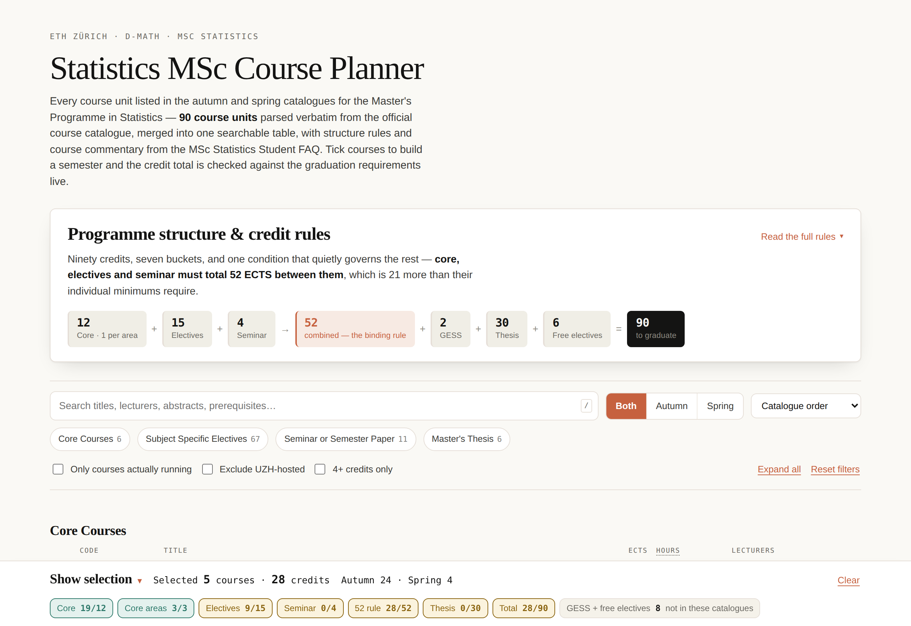

# MSc Statistics @ ETH — Course Planner

A single-page course browser and credit planner for the ETH Zürich MSc in Statistics,
built from the official course catalogue.

**There is no hosted site.** Clone or download the repo and open `index.html` in a
browser — the page is fully self-contained, so it needs no server and no build step.
GitHub Pages is deliberately switched off; see [NOTICE.md](NOTICE.md).



## What it does

- **All 90 course units** from the autumn and spring catalogues in one table, parsed
  verbatim — abstract, learning objective, content, prerequisites, literature, lecture
  notes and the competency matrix for each.
- **Full-text search** across abstracts and prerequisites, not just titles, so "causal",
  "R", or "high-dimensional" surfaces courses whose titles never say so.
- **Live requirement checking.** Tick courses and the bar checks the selection against
  the degree regulations: 12 ECTS core with one course per area, 15 electives, 4 seminar,
  the 52 rule, 30 thesis, 90 total.
- **Programme rules** — the credit ladder, registration and exam rules, and course-level
  commentary from the MSc Statistics Student FAQ.
- **Exam record per course** — average, pass rate, number examined and how many of them
  were MSc Statistics students, from ETH's own grade-statistics reports. Headline figures
  come from the most recent sitting; every sitting is listed underneath, because a single
  number hides trends like Fundamentals of Mathematical Statistics going 92.8% → 66.0%
  pass across three autumns. 52 of the 84 catalogue courses have a record.
- **Free Electives and Science in Perspective**, which the two curriculum catalogues
  only link out to, carry hand-added courses from individual catalogue prints — see
  `extra/`. The credit checker tracks GESS (2) and free electives (6) alongside the rest.
- Deep links per course to the ETH catalogue entry and to coursereview.ch.

## Repository layout

| File | Role |
|---|---|
| `parse.py` | PDF → `courses.json`. The whole extraction pipeline. |
| `build.py` | `courses.json` → `index.html`. Page template, styles and FAQ layer. |
| `courses.json` | The parsed catalogue, 90 records. The useful artifact if you only want data. |
| `index.html` | Generated page. Committed so GitHub Pages can serve it directly. |
| `pdf/` | The two catalogue prints the parse reads. |
| `robots.txt` | Legacy of the period when the page was served; harmless now. |
| `gradestats/` | The exam-record layer: derived data, and the scripts that produced it. Optional — delete it and rebuild for a page with no grade figures. |
| `extra/` | Hand-added courses, same record shape as `courses.json`. Optional — delete it and rebuild for only what the two curriculum PDFs contain. |

## Rebuilding

```bash
python3 parse.py     # pdf/*.pdf  -> courses.json   (needs pdftotext, from poppler-utils)
python3 build.py     # courses.json + gradestats/ + extra/ -> index.html   (no deps)
```

Both honour environment overrides: `PDF_DIR`, `COURSES`, `OUT`.

To refresh for a new semester, print the catalogue pages from
`vvz.ethz.ch` (Statistics Master curriculum, "Catalogue data" view, print to PDF) into
`pdf/`, then re-run both scripts. Filenames only need to contain "Autumn" or "Spring".

## The hand-added layer

The curriculum catalogues carry no course rows for Free Electives or Science in
Perspective — those sections link out to separate catalogues — and new courses appear
after the curriculum pages are printed. `extra/extra.json` holds such courses in the
same record shape as `courses.json`, and `build.py` appends it.

One caveat is wired into the page, because it bites every time a course is added. The
catalogue's **"Catalogue data" view does not print the ECTS value** — it lives in the
separate "Courses" view — so a course transcribed from that view should be given
`"ects": null` rather than a guess. The page renders null as **?** in amber, flags it
*ECTS to confirm*, counts it as **0** in every total, and says in the selection panel how
many of the selected courses carry no confirmed figure, so a total containing one reads
as a floor rather than a sum. Fill the number in and rebuild to clear it.

Currently added, all with confirmed credit values: Robot Learning (subject-specific
elective, 5), Large-Scale AI Engineering (free elective, 3), Building Agentic AI Systems
(free elective, 3), Soccer Analytics (Science in Perspective, 3).

## The exam-record layer

`gradestats/gradestats.json` is built from five ETH reports, *Notendurchschnitte pro Fach
und Stufe für Master-Studiengang Statistik*, covering exam sessions W24, S24, W25, S25 and
W26 (HS 2023 through HS 2025). **The source PDFs are not in this repository** — see
NOTICE.md for why.

Extracting them was harder than it looks, for one reason worth knowing:

**Every source report is redacted, three different ways** — vector rectangles, a raster
image overlay, and redaction burnt into a page scan. In one file the black boxes are drawn
*over live text*, so ordinary text extraction silently recovers figures that were
deliberately hidden. `gradestats/visible.py` therefore renders each page and measures the
mean luminance beneath every word's bounding box, discarding anything sitting on a black
field. Only text a human can actually see is used.

Two further traps: one file stores landscape pages as rotated portrait, so word coordinates
arrive in a different space from the render and every column lands wrong until the page's
rotation matrix is applied; and three of the five files have no text layer at all, so those
were transcribed by eye from page renders with tesseract as a cross-check. OCR was wrong
often enough to matter — it read `39.3` where the page shows `89.3`. Column assignment is
verified against the identity `%best = 100 × best / (best + n.best)`, which passes for
every programmatically parsed row.

## Notes on the parser

The catalogue is a fixed-width layout, not a table, which makes three things non-obvious:

1. **The value column drifts between pages.** Computing the label/value split once per
   course corrupts any course spanning a page break, so the split is derived per line
   from the left gutter.
2. **One line can carry two columns.** A wrapped title and a wrapped lecturer list share
   a line, so continuation lines are split at the lecturer column rather than taken whole.
   Without this, `Responsible Machine Learning with Insurance Applications` absorbs
   `C. Lorentzen-Geiser`.
3. **Lists are printed without bullets.** Wrapped prose always produces at least one
   long line, so a multi-line block where nothing is long is a list, not a paragraph.

### Verification

The parse is checked by a bidirectional word-level diff against the source text, per
course: **0 content words missing, 0 added**. Because that check compares whole records,
it cannot catch a word moving *between* fields within one course — a second check exists
for that (no title may end in initial-plus-surname; no lecturer field may contain prose
words), and that is how bug 2 above was found.

### Known source quirks

These are in the catalogue itself, not parse errors:

- `447-6237-00L` and `401-3620-24L` have genuinely empty Abstract fields.
- Four autumn courses have no lecturer listed; all are either not running or UZH-hosted.
- `401-3602-00L` lists its lecturer literally as "not available".
- Six codes appear in both catalogues — all administrative (semester papers, thesis,
  Scientific Works, Lunch Sessions). They are counted once by the planner.
- Free Electives, Science in Perspective and Additional Admission Requirements carry no
  course rows in these PDFs; those sections link out to other catalogue pages.
- The spring catalogue's "does not take place this semester" flags describe that specific
  spring and are not shown, since availability in a later spring is not yet published.

## Sources and status

See [NOTICE.md](NOTICE.md). Short version: the course data is ETH Zürich's, the
commentary and grade figures come from a student-run FAQ and are unofficial, and nothing
here is an authoritative statement of the study regulations.

## Licence

The code (`parse.py`, `build.py`, the page template) is MIT. The catalogue content and
FAQ excerpts it processes are not the author's to license — see NOTICE.md.
